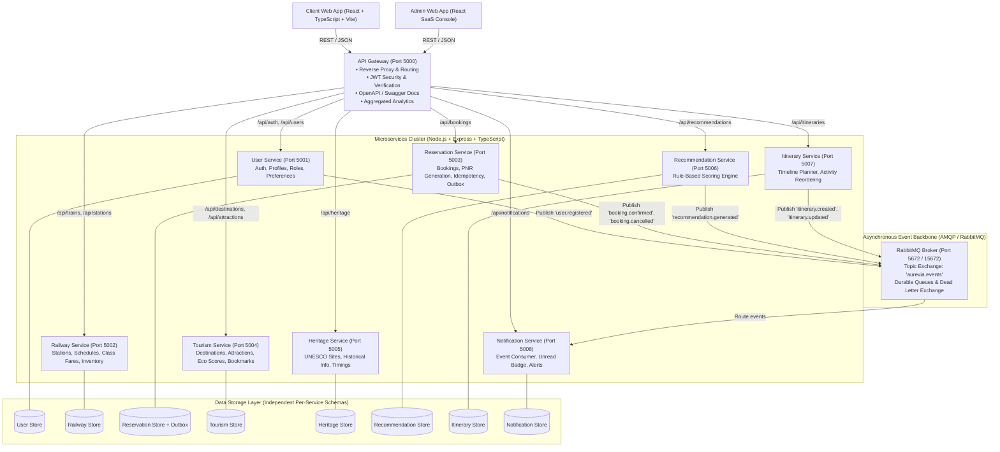

# AUREVIA – System Architecture Specification

## 1. Executive Summary

**AUREVIA** is an enterprise-grade smart tourism and simulated railway reservation platform built upon an **Event-Driven Microservices Architecture**. It addresses the fragmentation of modern travel planning by integrating destination discovery, cultural heritage awareness, carbon footprint calculation, custom itinerary planning, and simulated high-speed railway reservations into a unified, reliable ecosystem.

---

## 2. System Architecture Diagram

---

## 3. Microservice Roles and Boundary Definition

| Microservice | Port | Database Scope | Key Responsibilities | Published Events | Consumed Events |
|---|---|---|---|---|---|
| **API Gateway** | 5000 | None (Stateless) | Centralized reverse proxy, JWT verification, rate-limiting headers, Swagger spec (`/api/docs`), system health check (`/api/health`), admin metrics aggregation (`/api/admin/analytics`). | None | None |
| **User Service** | 5001 | `users` | User registration, login, bcrypt password hashing, JWT signing, profile updates, travel preference storage, admin activation toggle. | `user.registered` | None |
| **Railway Service** | 5002 | `railway` | Station directory, train routes, timings, distance calculation, class fares, simulated seat inventory management. | None | None |
| **Reservation Service** | 5003 | `reservations` | Booking creation, PNR generation, idempotency key checks, seat allocation, booking cancellation, transactional outbox persistence. | `booking.confirmed`, `booking.cancelled` | None |
| **Tourism Service** | 5004 | `tourism` | Curated Indian destinations, tourist spots, eco-friendly scores, sustainable travel guidelines, saved places. | `destination.viewed` | None |
| **Heritage Service** | 5005 | `heritage` | UNESCO World Heritage monuments, ancient temples, forts, visiting timings, ticket tariffs, architectural notes, saved heritage. | None | None |
| **Recommendation Service** | 5006 | `recommendations` | Rule-based scoring algorithm matching user categories, trip duration, regional preferences, and calculating human-readable explanations. | `recommendation.generated` | None |
| **Itinerary Service** | 5007 | `itineraries` | Day-by-day travel timeline planning, activity addition, duration scheduling, itinerary deletion. | `itinerary.created`, `itinerary.updated` | None |
| **Notification Service** | 5008 | `notifications` | Asynchronous event subscription, notification database storage, unread count tracking, in-app notification retrieval and read status updates. | None | `booking.*`, `user.*`, `itinerary.*` |

---

## 4. Key Architectural Patterns

1. **Database-Per-Service Pattern:** Every microservice manages its own isolated storage. Direct SQL joins between microservices are strictly prohibited; services communicate solely through synchronous REST requests or asynchronous event publishing.
2. **Transactional Outbox Pattern:** When a train reservation is committed, the event record is saved atomically in the reservation datastore. The outbox dispatcher then publishes the event to RabbitMQ, guaranteeing at-least-once delivery.
3. **Idempotency Key Pattern:** Every booking request carries a client-generated unique idempotency key. If network retries duplicate a request, the Reservation Service detects the key and returns the existing booking rather than creating duplicate seats or double charges.
4. **Resilient Broker Adapter Pattern:** The shared event bus supports RabbitMQ AMQP topic exchanges with automatic fallback to an in-process persistent event broker when running in standalone development environments without an active Docker daemon.
