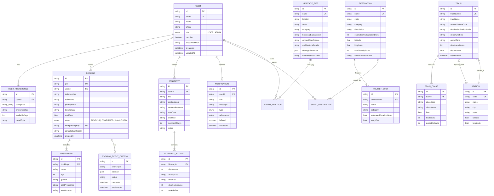

# AUREVIA – Database Design & Entity Relationships

## 1. Relational Database Strategy

AUREVIA uses a **Database-Per-Service** architectural pattern. In a production PostgreSQL deployment, each microservice manages its own schema (`users`, `railway`, `reservations`, `tourism`, `heritage`, `recommendations`, `itineraries`, `notifications`).

In local standalone execution, each service operates an ACID-compliant, JSON/SQLite-compatible relational store with atomic file writes and schema validation, perfectly mirroring the PostgreSQL schema.

---

## 2. Entity-Relationship (ER) Diagram

---

## 3. Data Integrity & Constraints

- **Unique Constraints:**
  - `users.email` (Case-insensitive unique identity)
  - `stations.code` (Unique 3-4 letter railway junction code, e.g., MAS, NDLS, ERS)
  - `trains.trainNumber` (Unique 5-digit Indian Railways service number, e.g., 20633)
  - `bookings.pnr` (Unique 10-character reference number, format `PNR-XXXX-XXXX`)
  - `bookings.idempotencyKey` (Guarantees zero duplicate booking operations on client retry)
  - `saved_destinations.(userId, destinationId)` (Prevents duplicate bookmarks)
  - `saved_heritage.(userId, heritageId)` (Prevents duplicate heritage saves)
