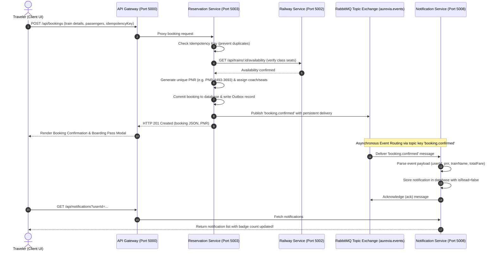

# AUREVIA – Event-Driven Workflow & Messaging Specification

## 1. Event Broker Configuration

AUREVIA utilizes **RabbitMQ** with AMQP protocol (with durable topic exchanges, durable queues, and dead-letter exchanges) alongside an in-process persistent event broker for standalone execution.

### Exchange & Queue Structure

- **Main Topic Exchange:** `aurevia.events` (durable, topic)
- **Dead Letter Exchange:** `aurevia.dlx` (durable, fanout)
- **Queues:**
  - `aurevia.queue.notifications` (Bound to `booking.*`, `user.*`, `itinerary.*`)
  - `aurevia.queue.analytics` (Bound to `#`)
  - `aurevia.queue.recommendations` (Bound to `destination.*`, `user.*`)
  - `aurevia.queue.dead_letter` (Dead-letter message deadpool)

---

## 2. Mandatory Demonstration Workflow: Ticket Reservation to Notification



---

## 3. Event Catalog and Schema Contracts

### `user.registered`
Published by **User Service** upon new account creation.
```json
{
  "eventId": "evt_1795343151023_hrajbvp",
  "eventType": "user.registered",
  "timestamp": "2026-11-22T10:25:51.023Z",
  "version": "1.0.0",
  "payload": {
    "userId": "usr_1795343151020_mwas",
    "email": "traveler@aurevia.com",
    "name": "Aarav Sharma",
    "role": "USER",
    "timestamp": "2026-11-22T10:25:51.020Z"
  }
}
```

### `booking.confirmed`
Published by **Reservation Service** upon successful reservation.
```json
{
  "eventId": "evt_1795343151130_z0cugur",
  "eventType": "booking.confirmed",
  "timestamp": "2026-11-22T10:25:51.130Z",
  "version": "1.0.0",
  "payload": {
    "bookingId": "bkg_1795343151129_bkdte",
    "pnr": "PNR-4493-3693",
    "userId": "usr_1795343151020_mwas",
    "trainId": "trn_20633",
    "trainNumber": "20633",
    "trainName": "Vande Bharat Express",
    "fromStation": "Chennai Central",
    "toStation": "Ernakulam Junction (Kochi)",
    "journeyDate": "2026-12-10",
    "departureTime": "06:00",
    "arrivalTime": "14:30",
    "travelClass": "CC",
    "passengers": [
      {
        "name": "Aarav Sharma",
        "age": 29,
        "gender": "MALE",
        "seatPreference": "WINDOW",
        "seatNumber": "C3-35"
      }
    ],
    "totalFare": 1580,
    "status": "CONFIRMED",
    "timestamp": "2026-11-22T10:25:51.129Z"
  }
}
```

### `booking.cancelled`
Published by **Reservation Service** upon booking cancellation.
```json
{
  "eventId": "evt_1795343151589_8y491e0",
  "eventType": "booking.cancelled",
  "timestamp": "2026-11-22T10:25:51.589Z",
  "version": "1.0.0",
  "payload": {
    "bookingId": "bkg_1795343151129_bkdte",
    "pnr": "PNR-4493-3693",
    "userId": "usr_1795343151020_mwas",
    "trainNumber": "20633",
    "journeyDate": "2026-12-10",
    "reason": "Schedule adjustment",
    "timestamp": "2026-11-22T10:25:51.588Z"
  }
}
```

### `itinerary.created`
Published by **Itinerary Service** upon saving a travel timeline.
```json
{
  "eventId": "evt_1795343151581_pbuuwt3",
  "eventType": "itinerary.created",
  "timestamp": "2026-11-22T10:25:51.581Z",
  "version": "1.0.0",
  "payload": {
    "itineraryId": "itin_1795343151580_nlot",
    "userId": "usr_1795343151020_mwas",
    "title": "Western Ghats Scenic Journey",
    "destinationId": "dest_munnar",
    "destinationName": "Munnar",
    "startDate": "2026-12-10",
    "endDate": "2026-12-13",
    "numberOfDays": 3,
    "timestamp": "2026-11-22T10:25:51.580Z"
  }
}
```

---

## 4. Failure Handling, Dead-Letter Exchanges, and Retries

- **Consumer Failures:** If the Notification Service fails during consumer execution, the message is not lost. The channel issues `nack(msg, false, false)`, routing the rejected message to `aurevia.dlx` and onto the `aurevia.queue.dead_letter` for manual inspection.
- **Outbox Reconciliation:** In the event of temporary RabbitMQ network partitions, the Reservation Service stores the event in `booking_event_outbox` with status `PENDING`. Once the broker reconnects, unsent events are republished.
- **Idempotent Consumers:** The Notification Service checks for duplicate event IDs (`eventId`) before inserting, guaranteeing idempotency in the consumer layer.
